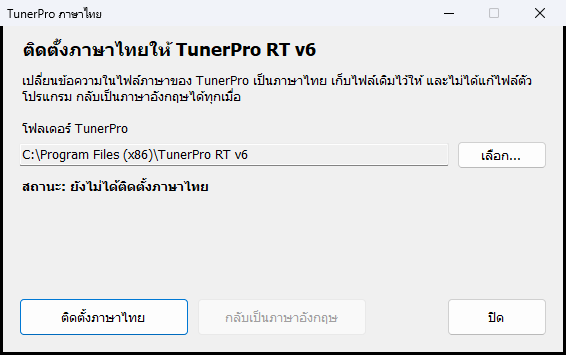
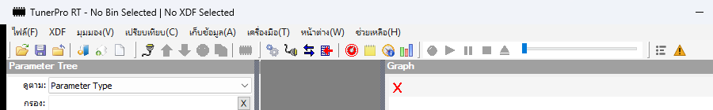
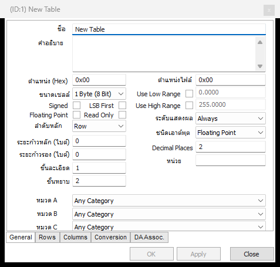

# TunerPro RT v6 ภาษาไทย

ทำให้ TunerPro RT v6 แสดงเมนู หน้าต่าง และข้อความแจ้งเตือนเป็นภาษาไทย ติดตั้งด้วยไฟล์เดียว กดปุ่มเดียวจบ

## ต้องมีอะไรก่อน

1. ติดตั้ง TunerPro RT v6 ในเครื่องก่อน หน้านี้ไม่ได้แจกตัวโปรแกรม โหลดได้จาก [tunerpro.net](http://www.tunerpro.net)
2. ใช้ Windows 10 หรือ 11
3. บันทึกงานแล้วปิด TunerPro ให้เรียบร้อย

## วิธีติดตั้ง

1. โหลดไฟล์ [TunerPro-Thai-Setup.exe](https://github.com/AlexDev-TH/tunerpro-thai/releases/latest/download/TunerPro-Thai-Setup.exe)
2. ดับเบิลคลิกไฟล์ที่โหลดมา
3. กดปุ่ม **ติดตั้งภาษาไทย**
4. Windows จะถามขออนุญาต ให้กด **Yes**
5. เปิด TunerPro ใช้งานได้เลย

ตัวติดตั้งจะหาโฟลเดอร์ TunerPro ให้เอง ถ้าหาไม่เจอให้กดปุ่ม **เลือก...** แล้วชี้ไปที่โฟลเดอร์ที่มีไฟล์ `TunerPro.exe`

### ถ้าตัวติดตั้งบอกว่าเครื่องยังไม่ได้ตั้งภาษาเป็นไทย

TunerPro เป็นโปรแกรมแบบเก่าที่ไม่ใช่ Unicode ถ้า Windows ไม่ได้ตั้งภาษาสำหรับโปรแกรมพวกนี้เป็นไทย เมนูจะเป็นตัวอ่านไม่ออก

ให้ติ๊กช่อง **ตั้งเป็นภาษาไทยให้เลย** ไว้แล้วกดติดตั้ง จากนั้นรีสตาร์ตเครื่องหนึ่งครั้ง

ค่านี้มีผลทั้งเครื่อง ถ้าในเครื่องมีโปรแกรมเก่าภาษาอื่น เช่น ญี่ปุ่นหรือจีน โปรแกรมพวกนั้นอาจแสดงผลเพี้ยน

### ถ้า Windows ขึ้นว่า Windows protected your PC

ไฟล์นี้ยังไม่ได้ซื้อใบรับรองของ Microsoft เลยขึ้นเตือนแบบนี้ ให้กด **More info** แล้วกด **Run anyway**

ถ้าไม่สบายใจ โค้ดทั้งหมดอยู่ในหน้านี้ อ่านแล้ว build เองได้ ดูหัวข้อ "แก้คำแปลหรือ build เอง" ด้านล่าง

## กลับเป็นภาษาอังกฤษ

เปิด `TunerPro-Thai-Setup.exe` อีกครั้ง แล้วกด **กลับเป็นภาษาอังกฤษ**

ตัวติดตั้งจะคืนไฟล์เดิมให้ตรงทุกไบต์ ถ้าตอนติดตั้งมีการเปลี่ยนภาษาของเครื่อง จะถามด้วยว่าให้เปลี่ยนกลับไหม

## หลังอัปเดต TunerPro

การอัปเดตจะเขียนไฟล์ภาษาทับ TunerPro จะกลับเป็นภาษาอังกฤษ ให้เปิดตัวติดตั้งแล้วกดติดตั้งใหม่อีกรอบ ข้อความใหม่ที่ยังไม่มีคำแปลจะแสดงเป็นภาษาอังกฤษ

## ส่วนที่ยังเป็นภาษาอังกฤษ

แปลครบทุกข้อความที่อยู่ในไฟล์ภาษาของ TunerPro ทั้งหมด 1,257 รายการ แต่ยังมีข้อความอีกส่วนที่ฝังอยู่ในตัวโปรแกรม ไม่ได้อ่านจากไฟล์ภาษา ส่วนนี้แปลไม่ได้ถ้าไม่แก้ไฟล์โปรแกรม เช่น

1. แถบสถานะด้านล่าง เช่น `Not Emulating` และ `DA: Not Connected`
2. ชื่อแผง `Parameter Tree` และ `Graph`
3. รายการส่วนใหญ่ในหน้าตั้งค่าโปรแกรม
4. ชื่อแท็บและปุ่ม `OK` `Apply` `Close` ในหน้าแก้ไข XDF และ ADX
5. ช่องติ๊กบางอัน เช่น `Signed` และ `LSB First`
6. คู่มือ Help (F12)

ส่วนชื่อพารามิเตอร์ใน XDF จะเป็นภาษาอะไรก็ตามที่คนทำ XDF เขียนไว้

คำศัพท์บางคำตั้งใจไม่แปล เช่น `Bin` `XDF` `ADX` `Checksum` `Size` เพราะคนจูนใช้กันแบบนี้อยู่แล้ว และช่องข้อความในโปรแกรมมีขนาดจำกัด

## ตัวติดตั้งทำอะไรกับเครื่องบ้าง

1. แก้ไฟล์ `lang\en.txt` ในโฟลเดอร์ TunerPro ให้เป็นภาษาไทย
2. เก็บไฟล์เดิมไว้ที่ `lang\en.txt.original`
3. ถ้าติ๊กช่องตั้งภาษาของเครื่อง จะเปลี่ยนค่านั้นให้ และจดค่าเดิมไว้ที่ `C:\ProgramData\TunerPro-Thai`
4. ถ้าใน `TunerProSettings.json` เลือกภาษาอื่นอยู่ จะตั้งกลับเป็น `en` และสำรองไฟล์เดิมเป็น `TunerProSettings.json.bak`

ไม่แก้ไฟล์ `.exe` หรือ `.dll` ของ TunerPro ไม่แตะไฟล์ Bin กับ XDF ของคุณ และไม่ได้เชื่อมต่ออินเทอร์เน็ต

ที่ต้องเขียนลง `en.txt` แทนการเพิ่มไฟล์ `th.txt` ตามคู่มือของ TunerPro เพราะหน้าแก้ไข XDF และ ADX อ่านข้อความจาก `en.txt` เท่านั้น ถ้าใช้ `th.txt` จะได้ภาษาไทยแค่บางส่วน

## ข้อควรระวัง

คำแปลทำขึ้นเองโดยไม่ได้เกี่ยวข้องกับผู้พัฒนา TunerPro ถ้าเจอข้อความไหนไม่แน่ใจ โดยเฉพาะตอนจะเขียนข้อมูลลงกล่องหรือลบรหัสปัญหา ให้กลับไปดูภาษาอังกฤษเทียบก่อน และสำรอง Bin ไว้เสมอ ใช้งานตามความเสี่ยงของตัวเอง

ทดสอบกับ TunerPro RT v6 รุ่น 6.0.419 บน Windows 11

## แก้คำแปลหรือ build เอง

คำแปลทั้งหมดอยู่ใน [lang/th.txt](lang/th.txt) เป็นไฟล์ UTF-8 อ่านและแก้บน GitHub ได้เลย เจอคำแปลแปลกหรือข้อความถูกตัด แจ้งใน Issues หรือส่ง Pull Request มาได้

เวลาแก้ให้เปลี่ยนแค่ข้อความฝั่งขวาของ `=` และระวังเรื่องพวกนี้

1. คง `%s` `%d` `%u` ไว้ตามลำดับเดิม
2. ข้อความหลัง `\t` คือปุ่มลัด ห้ามแก้
3. เมนูใช้รูปแบบ `ไฟล์(&F)` เพื่อให้กด Alt+F ได้เหมือนเดิม
4. ป้ายในหน้าต่างมีขนาดตายตัว ถ้าคำยาวกว่าเดิมมาก ข้อความจะถูกตัดหาย ควรเขียนให้สั้นเท่าภาษาอังกฤษหรือสั้นกว่า

build ตัวติดตั้งเองได้โดยดับเบิลคลิก `build.bat` ไม่ต้องลงโปรแกรมเพิ่ม เพราะใช้ตัวคอมไพล์ที่มากับ Windows ไฟล์ที่ได้จะอยู่ในโฟลเดอร์ `dist`

## ลิขสิทธิ์

TunerPro เป็นลิขสิทธิ์ของ Mark Mansur และ Creational Technologies, LLC โปรเจกต์นี้ไม่ได้เป็นของผู้พัฒนา TunerPro และไม่มีไฟล์ของโปรแกรมอยู่ในนี้ แค่เปลี่ยนข้อความในไฟล์ภาษาบนเครื่องที่ติดตั้ง TunerPro อยู่แล้ว
